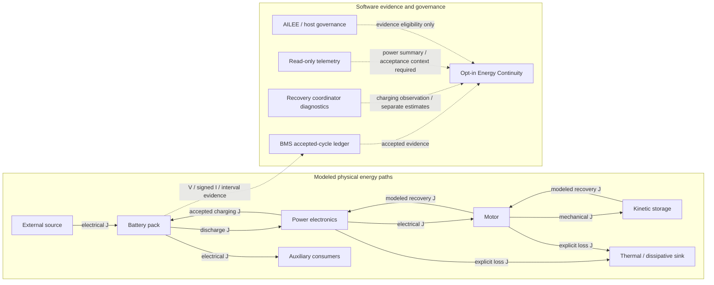

# DS-EV
**Battery Intelligence, Energy Recovery & Safety Governance**

[](LICENSE)
[](https://isocpp.org/)
[](docs/SAFETY.md)
[](docs/POST_BEDROCK_REMEDIATION_BACKLOG.md)
[](https://github.com/dfeen87/DS-EV/releases/tag/v9.0.0)
[](https://github.com/dfeen87/DS-EV/actions/workflows/ci.yml)

## Research-Stage EV Battery Management & Control Architecture

DS-EV is an actively developed C++17/Python research framework for dual-state battery modeling, health and degradation estimates, battery-aware torque and regenerative-energy logic, BMS middleware, automotive governance reference components, and optional physical energy accounting.

Engineering work focuses on input validation, raw-evidence preservation, explicit protection boundaries, regression-tested state integrity, and fail-closed software update/rollback processes. These are **software engineering practices**, not proof of vehicle safety, performance, or accuracy.

> **Vehicle safety notice:** DS-EV is **not vehicle-validated, road-ready, or automotive safety-certified**. Do not connect its examples, scripts, or computed commands to a live vehicle, traction inverter, charger, brake system, or battery actuators. Use software simulation and non-actuating research environments only. Any eventual vehicle application needs independent system hazard analysis, hardware-in-the-loop (HIL) and fault-injection validation, real hardware integration testing, applicable functional-safety assessment, and qualified engineering oversight. HIL alone does not confer certification.

**Version status:** [v9.0.0 — BEDROCK REFORGED: ENERGY CONTINUITY](https://github.com/dfeen87/DS-EV/releases/tag/v9.0.0) was **published October 11, 2026** as research-stage software. The [v8.0.2 development report](docs/RELEASE_8.0.2.md) preserves intervening work; v9 engineering reports document pre-publication verification snapshots. Publication and passing CI do not establish vehicle readiness or an authenticated updater payload.

**v9.0.0 engineering footprint since v8.0.1:** 40 commits, 63 changed files, **13,300 additions + 1,341 deletions = 14,641 lines changed**. The campaign addressed fifteen scoped BEDROCK findings and added opt-in Energy Continuity.

**Start with:** [Published v9.0.0 release](https://github.com/dfeen87/DS-EV/releases/tag/v9.0.0) · [V9 engineering report](docs/RELEASE_9.0.0.md) · [Simulation and validation report](docs/SIMULATION_VALIDATION_9.0.0.md) · [Earlier independent audit](docs/RELEASE_READINESS_AUDIT_9.0.0.md) · [Post-BEDROCK backlog](docs/POST_BEDROCK_REMEDIATION_BACKLOG.md) · [Safety scope](docs/SAFETY.md) · [Simulation quick start](#-simulation-only-quick-start) · [Citation](CITATION.cff)

## Evidence & Release Status

| Surface | Currently supported evidence | Not established |
|---|---|---|
| DS core and middleware | C++ compilation, CTest regressions, deterministic simulation, fixes to selected safety/state boundaries | Physical battery-model validation or vehicle safety |
| Automotive AILEE/governance | C++/Python reference paths, targeted adversarial regression tests, configurable protection rules | Certification for drivetrain, brake, or charge actuation |
| Energy Continuity | Optional directed physical-transfer records, checked joule accounting, explicit-boundary reconciliation, deterministic simulated scenarios | Sensor authenticity, complete physical observations, experimentally measured losses or regenerative recovery |
| Python fallback/extension | Python unit tests; separate CI build and smoke test for optional pybind11 extension | Numerical equivalence of the approximate fallback to C++ |
| Update and rollback | Authenticated-payload gates, protected evidence/backup tests, historically pinned offline maintenance migration guidance | A separately authenticated, digest-pinned v9.0.0 updater payload; atomic/power-loss-safe deployment |
| Performance and benefit | Runnable examples and local benchmark targets | Independent accuracy, battery-life, range, worst-case latency, or CPU/memory benefit claims |

**Remediation status:** The [PB-01 through PB-15 matrix](docs/RECOVERY_LEARNING_AUDIT_REMEDIATION.md) records bounded software-finding closure against passing regressions, including recovery, target lifetime, audit and numerical fixes. Local rollback identity requires rebuilt consumers; durable/live-revocation APIs, regeneration attribution, audit durability/authenticity and broader physical validation remain limitations. Historical reports describe their specific phases, not current release completeness.

The earlier independent audit reviewed `038653cd6600318e36276001099960dc8c523c3a`. Its release-preparation verdict does not assess the continuity code added afterward; the [v9 simulation report](docs/SIMULATION_VALIDATION_9.0.0.md) records subsequent feature tests and final-diff review, including [independent cross-boundary validation](https://github.com/dfeen87/DS-EV/pull/53).

---

## 📋 Table of Contents

- [Research Stage and Safety](#research-stage-ev-battery-management--control-architecture)
- [Evidence & Release Status](#evidence--release-status)
- [Why This Matters](#-why-this-matters)
- [Key Features](#-key-features)
- [Energy Continuity](#energy-continuity)
  - [V9 Simulation Highlights](#v9-simulation-highlights)
- [Performance & Validation Evidence](#performance--validation-evidence)
- [Advanced Features & Examples](#-advanced-features--examples)
- [DS Torque Enhancement Module](#ds-torque-enhancement-module-v20)
- [AILEE Automotive Governance Layer](#ailee-automotive-governance-layer)
- [BMS Middleware, Hardware Adapters & OEM Integration](#bms-middleware-hardware-adapters--oem-integration)
- [Intelligent Regenerative Braking](#-intelligent-regenerative-braking-ds-regen-module)
- [Closed-Loop Energy Recovery](#-closed-loop-energy-recovery-battery--torque--braking--battery)
- [Optional Telemetry Interface](#-optional-telemetry-interface)
- [Repository Structure](#-repository-structure)
- [Energy Recovery Discussion](#-closed-cycle-energy-recovery)
- [Simulation-Only Quick Start](#-simulation-only-quick-start)
- [Quick Start C++ Guide](#-quick-start-c-guide)
- [Integration Guide](#-integration-guide)
- [Validation & Testing](#-validation--testing)
- [Continuous Integration](#-continuous-integration)
- [Research Use Cases](#-research-use-cases)
- [Architecture](#-architecture)
- [Safety & Reliability](#-safety--reliability)
- [Roadmap](#-roadmap)
- [Citation](#citation)
- [License](#license)

---

## 🚀 Why This Matters

Battery behavior depends on instantaneous readings (voltage, current, temperature, SOC) and accumulated stress. DS-EV explores combining those signals in a dual-state model to produce **research estimates** of health, charging behavior, and battery-aware power constraints.

### The Research Question

Can explicitly modeled stress history improve state estimates and support more consistent protective decisions than instantaneous-only modeling? This is a hypothesis to test—not a demonstrated improvement over a commercial BMS.

### The DS Approach

```text
Battery readings + modeled stress history
             ↓
       DS state and estimates
             ↓
Governed power/regen recommendations, diagnostics, simulation
```

The code exercises software protection contracts; it does **not** establish a percentage improvement in degradation detection or vehicle battery longevity.

---

## ⚡ Key Features

- **Dual-state modeling:** Physical state combined with accumulated modeled stress/entropy and candidate battery-health estimates.
- **BMS and multi-cell integration:** Chemistry profiles, state aggregation, diagnostic middleware and reference hardware-adapter boundaries.
- **Torque and regen modeling:** Battery-aware software *recommendations*, not authorized real-vehicle commands.
- **Automotive governance:** Reference trust/protection-envelope evaluation with adversarial regression coverage.
- **Energy Continuity:** Opt-in physical joule accounting with explicit source/destination, event identity, evidence origin, storage changes and balance/imbalance/incomplete outcomes.
- **Engineering validation:** C++/Python testing, state-integrity remediation, authenticated updater gates, and protected backup/restore checks.

This repository is **not** a drop-in, two-line vehicle integration.

---

## Energy Continuity

The optional layer observes physical energy evidence without changing existing DS equations, BMS accepted-cycle results, recovery recommendations or AILEE authority. It reconciles a declared boundary using `E_initial + E_in = E_final + E_out + E_dissipated`. Internal accounting uses joules; `1 kWh = 3,600,000 J`.

For accepted battery observations, `Delta E_signed = V * I * dt`: positive current means discharge and negative current means charging. The BMS owns its accepted raw-current ledger. Coordinator charging totals describe the same accepted energy and must not be added to that ledger; mechanical/electrical recovery availability remains a separate estimate. Negative measured current does not prove a regenerative source.

The diagram separates illustrative physical transfers (solid arrows, joules) from software evidence and governance (dotted arrows). Node names do not imply complete plant models or available hardware measurements. Loss transfers require explicit supplied evidence.



### V9 Simulation Highlights

The following are **synthetic, deterministic software results**, not physical vehicle measurements:

- Four discharge/braking intervals each reconciled with a **0 J residual**, alongside **8,000 J of explicitly modeled thermal dissipation**.
- Accepted battery charging totaled **12,000 J** across the two braking intervals, counted once despite the recovery coordinator's accounting alias.
- Independent component-boundary tests surfaced **+5 J** of unexplained inverter input and **−20 J** of motor imbalance when evidence was declared complete.
- Compensated summation exposed a **1 J** discrepancy beside a **10²⁰ J** energy inventory under zero tolerance.
- The v9 follow-up passed **23/23 hosted CTest tests**, including the dedicated cross-boundary simulation suite.

Each result depends on the modeled boundary and supplied evidence. The ledger reconciles individual intervals; **it does not enforce matching storage endpoints across successive events**. Review the [simulation evidence](docs/SIMULATION_VALIDATION_9.0.0.md) and [independent tests in PR #53](https://github.com/dfeen87/DS-EV/pull/53) for analytic oracles, reproduction commands, and limitations.

Transactions stage validated records before commit, reject malformed/nonfinite/overflowing evidence and duplicate identities, and have bounded session/reset behavior. Declared incomplete storage or transfer evidence produces **insufficient evidence**; claiming complete storage while omitting a selected node rejects as malformed. An unexplained residual is never assigned to heat, and a zero residual from dependent estimates is not independent physical validation. Core informational energies such as `energy_phi` or `energy_metric` are not physical transfer measurements.

The passive adapter captures a checkpoint before the caller's existing BMS cycle and observes exactly one accepted cycle afterward. A BMS reinitialization requires a newer continuity session and a fresh checkpoint. Reconciliation balances the supplied per-event storage endpoints; it does not certify continuous physical history across events or unobserved intervals.

Run the fixed-input software example:

```bash
cmake -S . -B build -DCMAKE_BUILD_TYPE=Release -DDS_ENABLE_PYTHON_GOVERNOR=OFF
cmake --build build --target energy_continuity_simulation test_energy_continuity test_cross_boundary_simulation
./build/energy_continuity_simulation
ctest --test-dir build -R 'energy_continuity|cross_boundary_simulation' --output-on-failure
```

The [release note](docs/RELEASE_9.0.0.md) describes the ownership and migration contracts. The [validation report](docs/SIMULATION_VALIDATION_9.0.0.md) records actual simulated values, analytic expectations, residuals, executed checks and limitations. No output is presented as a hardware measurement or safe actuator instruction.

---

## Performance & Validation Evidence

The repository contains local benchmark sources: [update](benchmarks/benchmark_update.cpp) and [multi-cell](benchmarks/benchmark_multicell.cpp). Measure the actual platform, compiler, workload and model configuration before quoting performance.

| Question | Evidence needed |
|---|---|
| Cycle latency, memory and CPU | Reproducible target-specific benchmarks; worst-case execution analysis for real-time use |
| Degradation-estimation accuracy | Representative calibrated battery datasets and out-of-sample baselines |
| Battery lifetime, charging and range | Independent physical/vehicle comparative testing |
| Integration effort and runtime guarantees | Target-specific engineering and integration measurements |

**Passing CI does not establish sub-millisecond deadlines, a 20–30% accuracy improvement, or universal footprint figures.** Optional/experimental GPU paths are not a verified automotive performance improvement.

---

## 🔧 Advanced Features & Examples

These components provide research paths for chemistry profiles, multi-cell models, Kalman filtering, and optional hybrid modeling. An interface or example does **not** establish hardware behavior or vehicle certification.

### ⚙️ Advanced Capabilities

1. **Chemistry profiles:** LFP, NMC, NCA, LTO and configurable stress/thermal parameters. Cell-specific correctness requires calibration and independent test evidence.
2. **Multi-cell modeling:** Reference pack aggregation, cell imbalance indicators, weak-cell flags, and health estimates. The [`multi_cell_pack.cpp` example](examples/multi_cell_pack.cpp) is **disabled in the default CMake example build due to API mismatches**; it is not a verified integration test.
3. **Kalman filtering:** Optional state-estimation filtering of model and sensor values; filter results need calibration and validation.
4. **ML hybrid (optional):** Exploratory interface concepts; no trained-model benefit is established.
5. **Fleet learning (proposed):** Potential aggregated chemistry/stress analytics, not a deployed opt-in fleet-data service.
6. **GPU (experimental):** Optional CUDA configuration and interface stubs are not a supported, benchmarked, safety-validated GPU execution pipeline.

Use [`examples/basic_integration.cpp`](examples/basic_integration.cpp) for a default-build software example.

---

## DS Torque Enhancement Module v2.0

### Overview

The **DS Torque Enhancement Module** models battery-aware torque limits in simulation. It is a research/reference implementation, **not** an independently validated vehicle command source or battery-protection guarantee.

Unlike traditional torque limiters that only consider instantaneous power limits, this module uses the dual-state DS framework (physical state + historical stress state) to make intelligent decisions about power delivery based on:
- **Long-term battery health** - Progressive derating as pack ages
- **Stress and temperature history** - Reduces power after demanding driving
- **Dynamic coupling** - Uses state and stress indicators
- **Cell-level health** - Protects weak cells in multi-cell packs
- **Thermal constraints** - Candidate derating based on model inputs; no shutdown-prevention guarantee

---

### Key Features

### 🚗 Multi-Mode Operation
- **Drive Modes**: ECO, NORMAL, SPORT, CUSTOM
- **Regen Modes**: LOW, MEDIUM, HIGH, ADAPTIVE
- Smooth mode transitions with configurable time constants
- DS-adaptive regen that optimizes for battery health

### 🔥 Advanced Thermal Management
- Real-time thermal modeling for motor, inverter, and battery
- Predictive derating based on thermal trajectory
- Component-specific temperature limits
- Cold weather performance optimization

### 🛡️ Comprehensive Safety Systems
- Multi-layer SOC protection (normal and critical limits)
- Automatic limp mode for critical battery states
- Torque rate limiting for smooth, predictable behavior
- Independent safety checks for all critical parameters

### 🔋 Cell-Level Intelligence
- Integration with multi-cell pack diagnostics
- Weak cell detection and protection
- Voltage imbalance compensation
- Dynamic derating based on pack health distribution

### ⚡ Performance Features
- **Overboost Mode**: Temporary power increase (configurable duration)
- **Launch Control**: Maximum acceleration from standstill
- **Dual-Motor Support**: Independent front/rear torque distribution
- **Traction Control Integration**: Hooks for slip control systems

### 📊 Rich Diagnostics
- Real-time performance metrics (avg/peak torque, power, efficiency)
- Thermal tracking (motor, inverter, battery temperatures)
- Derate event logging and limiting factor identification
- Microsecond-precision timing measurements

---

### Architecture

```
┌─────────────────────────────────────────────────────────────────┐
│                    DS Torque Manager                           │
├─────────────────────────────────────────────────────────────────┤
│                                                                 │
│  ┌──────────────┐    ┌──────────────┐    ┌──────────────┐    │
│  │  DS Battery │───▶│   Torque     │───▶│    Motor     │    │
│  │    State     │    │  Computation │    │   Commands   │    │
│  └──────────────┘    └──────────────┘    └──────────────┘    │
│         │                    │                    │            │
│         ▼                    ▼                    ▼            │
│  ┌──────────────┐    ┌──────────────┐    ┌──────────────┐    │
│  │  Health &    │    │  Thermal     │    │ Front/Rear   │    │
│  │  Degradation │    │  Model       │    │ Distribution │    │
│  └──────────────┘    └──────────────┘    └──────────────┘    │
│         │                    │                    │            │
│         └────────────────────┴────────────────────┘            │
│                              │                                 │
│                              ▼                                 │
│                    ┌──────────────────┐                        │
│                    │   Diagnostics    │                        │
│                    │   & Logging      │                        │
│                    └──────────────────┘                        │
└─────────────────────────────────────────────────────────────────┘
```

---

### Torque Computation Pipeline

The module uses a multi-factor scaling approach:

```
Final Torque = Base Motor Torque × Combined Scaling Factor

Combined Scaling = 
    Base Motor Curve (speed-dependent)
  × DS Health Factor (remaining capacity)
  × DS Stress Factor (historical stress)
  × DS Dynamic Coupling Factor
  × Thermal Factor (motor + inverter + battery)
  × SOC Factor (state of charge protection)
  × Cell Balance Factor (weak cell protection)
  × Drive Mode Factor (ECO/NORMAL/SPORT)
  × Overboost Factor (if active)
```

These are modeled factors, not a physical safety proof. Actual actuation authority must come from an independently assessed host system.

---

### Integration Examples

**Schematic simulation pseudocode:** The following snippets contain host placeholders and may not compile against the current API. They illustrate intent, not approved actuator integration. For a built example, start with [`examples/basic_integration.cpp`](examples/basic_integration.cpp).

### Basic Integration (Single Motor, Simple BMS)

```cpp
#include "torque_enhancement.hpp"
#include "ds_bms_middleware_v2.hpp"

// Initialize BMS
ds_plugin::DSBMSMiddleware bms;
bms.init(75.0, 400.0);  // 75Ah, 400V

// Configure torque manager
ds::drive::TorqueConfig config;
config.drive_mode = ds::drive::DriveMode::NORMAL;
config.drivetrain.rear_motor.peak_torque_nm = 400.0;
config.battery.max_discharge_power_kw = 250.0;

ds::drive::DSTorqueManager torque_mgr(config);

// Hypothetical simulation loop; timing is not validated on vehicle hardware:
void control_loop() {
    double dt = 0.01;  // 10ms
    
    // Update BMS with sensor data
    auto enhanced = bms.enhance_cycle(voltage, current, temperature, soc, dt);
    
    // Get torque limit
    double motor_rpm = read_motor_speed();
    auto result = torque_mgr.compute_torque_limit(enhanced, motor_rpm, dt);
    
    // Apply limit to driver request
    double driver_request = read_accelerator_pedal() * 400.0;
    double commanded_torque = std::min(driver_request, 
                                      result.max_drive_torque_nm);
    
    // Simulation only: modeled torque; do not send to a real motor controller.
    (void)commanded_torque;
    
    // Handle warnings
    if (result.thermal_derate_active) {
        show_warning("Thermal limiting active");
    }
}
```

### Advanced Integration (Multi-Cell Pack, Dual Motor)

```cpp
// Initialize multi-cell pack BMS
ds_plugin::MiddlewareConfig bms_cfg;
bms_cfg.mode = ds_plugin::MiddlewareConfig::Mode::MULTI_CELL_PACK;
bms_cfg.chemistry = ds::advanced::ChemistryType::NMC;
bms_cfg.series_cells = 96;
bms_cfg.enable_kalman_filter = true;

ds_plugin::DSBMSMiddleware bms;
bms.init_advanced(bms_cfg);

// Configure dual-motor torque manager
ds::drive::TorqueConfig config;
config.drivetrain.has_front_motor = true;
config.drivetrain.has_rear_motor = true;
config.drivetrain.front_motor.peak_torque_nm = 300.0;
config.drivetrain.rear_motor.peak_torque_nm = 400.0;
config.ds_weights.enable_cell_aware_limiting = true;

ds::drive::DSTorqueManager torque_mgr(config);

// In control loop:
void advanced_control_loop() {
    std::vector<double> cell_voltages = read_all_cell_voltages();
    std::vector<double> cell_temps = read_all_cell_temperatures();
    double pack_current = read_pack_current();
    
    // Update multi-cell pack
    bms.update_pack(cell_voltages, cell_temps, pack_current, dt);
    
    // Get pack diagnostics for cell-aware limiting
    auto pack_diag = bms.get_diagnostics();
    auto health = bms.get_health_forecast(100.0);
    
    // Compute torque with cell awareness
    auto result = torque_mgr.compute_torque_limit(enhanced, motor_rpm, 
                                                  dt, &pack_diag);
    
    // Apply front/rear split
    double front_torque = result.max_drive_torque_nm * 
                         result.front_torque_fraction;
    double rear_torque = result.max_drive_torque_nm * 
                        result.rear_torque_fraction;
    
    // Simulation only: record modeled front/rear outputs; do not actuate.
    (void)front_torque;
    (void)rear_torque;
    
    // Handle weak cells
    if (result.weak_cell_derate_active) {
        auto weak_cells = bms.get_weak_cells();
        // Any cell balancing requires a separately validated host controller.
    }
}
```

### Launch Control Example

```cpp
// Enable performance features
config.enable_launch_control = true;
config.enable_overboost = true;
config.overboost_duration_s = 15.0;
config.drive_mode = ds::drive::DriveMode::SPORT;

ds::drive::DSTorqueManager torque_mgr(config);

// Launch control logic
bool launch_armed = false;

void launch_control_handler() {
    // Arm launch control
    if (vehicle_stopped() && brake_pressed() && throttle_full()) {
        launch_armed = true;
        show_message("Launch Control Armed");
    }
    
    // Execute launch
    if (launch_armed && !brake_pressed()) {
        auto result = torque_mgr.compute_torque_limit(enhanced, 0.0, dt);
        
        if (result.overboost_active) {
            // Simulated overboost candidate, NOT a physical launch command
            commanded_torque = result.max_drive_torque_nm;
            show_message("OVERBOOST ACTIVE");
        }
        
        launch_armed = false;
    }
}
```

---

### Configuration

### Drive Modes

| Mode | Power Fraction | Behavior |
|------|---------------|----------|
| **ECO** | 60% | Gentle acceleration, maximum efficiency |
| **NORMAL** | 85% | Balanced performance and efficiency |
| **SPORT** | 100% | Maximum performance, aggressive response |
| **CUSTOM** | User-defined | Custom tuning parameters |

### Regen Modes

| Mode | Behavior |
|------|----------|
| **LOW** | Minimal regenerative braking, coast-like feel |
| **MEDIUM** | Moderate one-pedal driving |
| **HIGH** | Aggressive one-pedal, maximum energy recovery |
| **ADAPTIVE** | DS-optimized based on battery health and temperature |

### DS Tuning Weights

```cpp
struct DSTorqueWeights {
    double health_influence = 0.40;          // 40% influence from health
    double degradation_influence = 0.25;     // 25% from degradation rate
    double entropy_influence = 0.20;         // 20% from stress history
    double metric_stress_influence = 0.15;   // 15% from dynamic coupling
    
    double min_torque_fraction = 0.20;       // Always allow ≥20% torque
    double max_ds_derate = 0.70;            // Max 70% DS reduction
};
```

These are research configuration parameters; impact on physical battery performance or longevity is not validated.

---

### Diagnostics and Monitoring

### Real-Time Metrics

```cpp
auto diag = torque_mgr.get_diagnostics();

std::cout << "Average Torque: " << diag.average_torque_nm << " Nm\n";
std::cout << "Peak Torque: " << diag.peak_torque_nm << " Nm\n";
std::cout << "Average Power: " << diag.average_power_kw << " kW\n";
std::cout << "Total Energy: " << diag.total_energy_kwh << " kWh\n";
std::cout << "Regen Energy: " << diag.regen_energy_kwh << " kWh\n";
std::cout << "Average Efficiency: " << diag.average_efficiency * 100 << "%\n";
std::cout << "Derate Events: " << diag.derate_event_count << "\n";
```

### Status Summary

```cpp
std::cout << torque_mgr.get_status_summary();
```

Output:
```
=== DS Torque Manager Status ===
Drive Mode: SPORT
Regen Mode: ADAPTIVE

Diagnostics:
  Average Torque: 285.4 Nm
  Peak Torque: 400.0 Nm
  Average DS Scaling: 92.3%
  Derate Events: 12
  Motor Temp: 78.5 °C
  Inverter Temp: 65.2 °C
```

### Limiting Factor Analysis

```cpp
auto result = torque_mgr.compute_torque_limit(enhanced, motor_rpm, dt);

std::cout << "Limiting Factor: " << result.limiting_factor << "\n";
std::cout << "Active Derates:\n";
if (result.health_derate_active) std::cout << "  - Health\n";
if (result.thermal_derate_active) std::cout << "  - Thermal\n";
if (result.entropy_derate_active) std::cout << "  - Stress\n";
if (result.soc_derate_active) std::cout << "  - SOC\n";
if (result.weak_cell_derate_active) std::cout << "  - Weak Cells\n";
```

---

### Safety Features (Software Policy Examples)

The following represent **configurable modeling and protection concepts**, not hardware actuator interlocks, guaranteed motor shutdown times, or universal battery thresholds:

1. **Hard/soft model limits:** Constrain calculated torque recommendations under configured policy.
2. **Rate limiting:** Model changes over successive accepted cycles; decreasing protection ceilings must take precedence where documented.
3. **Fault and limp-mode recommendations:** Represent constrained or rejected software outputs, not validated actual vehicle emergency actions.
4. **SOC/temperature boundaries:** Depend on chemistry, host configuration, operating evidence, and applicable regression tests.

Numerical thresholds must be confirmed against the configured policy and appropriate host safety analysis. Consult [safety scope](docs/SAFETY.md) and [v8.0.1 evidence](docs/RELEASE_8.0.1.md).

---

### Performance Characteristics

Outputs depend on the configured battery/motor envelope and input sequence. A fixed example table cannot establish universally safe available torque.

**No verified worst-case execution time, emergency-stop latency, or battery-life improvement is provided by the current software tests.** Previous example figures (including sub-100-µs timing and 15–25% lifetime benefit) are not independent performance evidence.

### Benefits and Research Questions

DS-EV explores whether battery-health, weak-cell and stress-history signals improve modeled torque governance. Comparative physical battery and vehicle outcomes remain unverified.

### Requirements

- C++17 and supported CMake toolchain.
- Current DS core/middleware interfaces; optional Python embedding requires a separate build setting.
- Simulation/research use only; hardware timing, concurrency and functional safety demand application-specific evidence.

---

### Thread Safety

⚠️ **Not thread-safe by default.** The torque manager maintains internal state and should be called from a single control thread. If multi-threaded access is required, implement external synchronization.

---

## AILEE Automotive Governance Layer

### Overview

The **AILEE Automotive Governance Layer** (`ds_core/python/ailee` and C++ `ds_ailee_governor`) is a reference software trust and protection boundary for modeled signals, scores and torque limits. Its governance evaluations are **not** a certified defense against physical vehicle faults or malicious command manipulation.

### Governance Levels & Derating Matrix

AILEE evaluates software vehicle-state/trust inputs and applies configured four-level governance envelopes (see `config/ailee_automotive_config.yaml`). These are **model authorization fractions**, not guaranteed safe drivetrain output:

| Level | Name | Cap Fraction (HP / Torque / Current) | Description |
|-------|------|--------------------------------------|-------------|
| **Level 0** | **Normal Operation** | **1.00 (100%)** | Full modeled envelope *when acceptable evidence and policy permit*. |
| **Level 1** | **Soft Ceiling** | **0.90 (90%)** | Soft derating applied when mild signal drift or thermal soft limits are approached. |
| **Level 2** | **Hard Ceiling** | **0.65 (65%)** | Hard derating applied when consistency or trust scores experience moderate anomalies. |
| **Level 3** | **Protective Mode** | **0.25 (25%)** | Configured derating fraction for eligible protective decisions; invalid/missing evidence may require **zero** authority instead. |

Configured envelope values are examples of current policy defaults, not universal safety constants. Invalid sensor evidence is expected to fail closed according to the tested boundary; see [v8.0.1](docs/RELEASE_8.0.1.md).

### Key Features & Components

- **C++ Native Governor (`AileeHorsepowerGovernor`)**: High-performance C++ execution engine that computes mechanical horsepower ($HP_{mech} = \frac{\tau \times RPM}{7121.23}$), electrical horsepower ($HP_{elec} = \frac{V \times I}{745.7}$), and signal consistency scores.
- **Optional Python trust pipeline (`AileeTrustPipeline`)**: Embedding is disabled in the default CMake configuration and requires an optional build; no zero-latency guarantee is established.
- **Software audit output**: Configured logging can record evaluated governance decisions; these logs are not independently authenticated vehicle black-box recordings.
- **Native evaluation path**: A C++ path exists without optional Python embedding; refer to the regression reports for its precise rejected-evidence behavior.

### C++ Integration Example

```cpp
#include "ailee_horsepower_governor.hpp"

// Initialize governor
AileeHorsepowerGovernor governor;

// Prepare vehicle raw signals
RawSignals signals;
signals.torque_nm = 400.0;
signals.rpm = 4000.0;
signals.v_batt = 400.0;
signals.i_batt = 400.0;
signals.ctx.soc = 85.0;
signals.ctx.soh = 95.0;
signals.ctx.temp_c = 30.0;
signals.ctx.sensor_valid = true;

// Evaluate governance policy
GovernanceDecisionCpp decision = governor.evaluate(signals);

std::cout << "Governance Level: " << decision.level << "\n";
std::cout << "Governed HP: " << decision.governed_hp << " HP\n";
std::cout << "Governed Torque: " << decision.governed_torque << " Nm\n";
std::cout << "Trust Score: " << decision.trust_score << "\n";
std::cout << "Reason: " << decision.reason << "\n";
```

### Python Integration Example

```python
from ailee.core_min import AileeTrustPipeline
from ailee.domains.automotive.ailee_automotive_domain import AileeAutomotiveDomain

# Instantiate trust pipeline with automotive domain
domain = AileeAutomotiveDomain(config_path="config/ailee_automotive_config.yaml")
pipeline = AileeTrustPipeline(domain=domain)

# Process signal evaluation
context = {
    "hp_mech": 224.68,
    "hp_elec": 214.56,
    "soc": 85.0,
    "soh": 95.0,
    "temp_c": 30.0,
    "sensor_valid": True
}

decision = pipeline.evaluate(context)
print(f"Level: {decision.level}, Governed HP: {decision.governed_hp}, Trust: {decision.trust_score}")
```

---

## BMS Middleware, Hardware Adapters & OEM Integration

DS-EV includes BMS middleware and **reference** ECU/hardware integration scaffolding, intended for software evaluation rather than direct vehicle installation or actuation.

### 🔧 DS BMS Middleware v2.0

A unified integration layer that connects:

- DS core models
- Multi-cell pack intelligence
- Safety monitoring & diagnostics
- Vehicle systems (e.g. torque management)

Key capabilities:

- Single-pack and full multi-cell operation
- Deterministic diagnostics (`DiagnosticReport`)
- Selected fail-closed sensor/evidence boundaries verified in the v8 engineering reports
- Clean API for torque, power, and UI systems
- C++17/header-based components; real-time deadlines require target-specific measurement

📁 `include/ds_bms_middleware_v2.hpp`

### 🔌 Reference Hardware Adapter

A software reference illustrating integration boundaries for:

- CAN-based pack telemetry
- Optional SPI/I2C cell monitor ICs
- Contactor and balancing commands
- Time sources and safety checks

This is **not a validated OEM integration**. Real CAN/DBC mapping, diagnostics, transport authenticity and actuator authority require independent host-specific engineering.

📁 `src/ds_bms_hardware_adapter.hpp`

### 📡 OEM CAN Mapping Reference

A clear, neutral CAN mapping document defining:

- Required pack-level signals
- Example CAN IDs and scaling
- Freshness and safety expectations
- Actuator command semantics
- Integration checklist for deployment

📁 `docs/oem_can_mapping.md`

---

## 🛑 Intelligent Regenerative Braking (DS Regen Module)

The repository includes a **DS-based regenerative braking reference manager** for simulated battery-aware torque limits.

The module computes **real-time, battery-aware regen torque limits** and a **recommended regen–friction blend**, using:
- state of charge and voltage headroom  
- battery temperature and charge acceptance  
- cell imbalance and weak-cell indicators  
- DS stress and confidence metrics
- ABS / ESC cooperation signals  

Any physical design must give independent vehicle brake, ABS and ESC systems priority. **DS-EV does not establish hardware arbitration, physical braking response times, or actuator safety.**

---

📁 **Files:**  

- `include/ds_regen_braking_manager_v1.hpp`
- `examples/regen_braking_loop.cpp`
- `docs/regen_braking_overview.md`


This completes the DS control loop:
**Battery Intelligence → Torque Intelligence → Braking Intelligence → Battery Health**

## 🔄 Closed-Loop Energy Recovery (Battery → Torque → Braking → Battery)

The earlier **v1.3.0** integration introduced the design goal of treating regenerative braking as an active, battery-aware charging event. The current overall release candidate is v9.0.0; component API versions are separate.

The software models battery-side energy updates and regen recommendations subject to policy limits. This is not evidence of measured physical recovery or safe charging.

A real implementation would require independently validated OEM brake/ESC arbitration and battery charging constraints. These are software integration concepts.

**Design goal:** Coherent software accounting for energy delivery and modeled recovery; remaining accounting questions are tracked in the remediation backlog.

---

## 📡 Optional Telemetry Interface

The DS stack exposes an optional, read-only telemetry snapshot designed to make OEM integration easier without imposing any dashboard or UI assumptions.

The telemetry struct provides a stable summary of:
- battery state (SOC / SOH)
- signed pack power (discharge vs all-source charging)
- accepted all-source charging energy under its legacy `recovered_energy_kwh` name
- key DS metrics (stress, confidence)
- active limiting factors

This interface is intended for dashboards, CAN mapping, logging, or cloud pipelines and does not participate in control decisions.

A snapshot alone does not identify a newly accepted cycle, a transfer source, an elapsed interval or regenerative origin. The opt-in continuity adapter requires explicit acceptance and interval context; it never sums the cumulative snapshot with the BMS/coordinator account.

Visualization, UX, and presentation remain fully owned by the automaker.

---

## 📁 Repository Structure

```text
DS-EV/
├── include/                   # DS core forwarding headers, BMS middleware,
│   ├── ailee_trust_layer/      # automotive governance reference components
│   └── battery_feen_adapter/   # optional adapter surface
├── src/                       # C++ governor, torque and hardware-adapter references
├── ds_core/                   # CLI/shared-library sources, Python wrapper/fallback
├── examples/                  # simulation and schematic integration examples
├── tests/                     # C++/Python regression and smoke coverage
├── benchmarks/                # locally runnable performance probes
├── config/                    # example configuration and policy files
├── scripts/                   # diagnostics, updater, backup/restore and migration
├── docs/                      # architecture, safety, release reports and backlog
├── .github/workflows/         # software CI
├── CITATION.cff
├── CMakeLists.txt
└── Makefile
```

Key entry points: [DS core](include/ds_battery_core.hpp), [BMS middleware](include/ds_bms_middleware_v2.hpp), [recovery coordinator](include/ds_energy_recovery_coordinator_v1.hpp), [Energy Continuity](include/ds_energy_continuity.hpp), [AILEE reference components](include/ailee_trust_layer/), [hardware adapter](src/ds_bms_hardware_adapter.hpp), [Python fallback](ds_core/python_fallback/ds_enhancer_fallback.py), and [v9.0.0 release candidate report](docs/RELEASE_9.0.0.md).

**Build detail:** `examples/multi_cell_pack.cpp` is retained as a reference but is excluded from the default CMake example build pending its API reconciliation. Read the [CMake targets](CMakeLists.txt) rather than assuming every example is compiled by CI.

---

## 🔄 Closed-Cycle Energy Recovery

The DS-EV research stack models the flow **Battery State → Torque Request → Vehicle Kinetics → Regeneration → Battery State**. This is a software representation of bounded energy transfer, not a perpetual-energy system or proof of additional physical recovery.

The [recovery coordinator](include/ds_energy_recovery_coordinator_v1.hpp) stages history until BMS acceptance and records battery-side charging separately from available mechanical/electrical estimates; see [PB-09 evidence](docs/RECOVERY_LEARNING_AUDIT_REMEDIATION.md). Negative measured current identifies charging with an unproven source. Coordinator totals observe the same accepted energy as the BMS ledger and must not be added to it.

---

## 🛑 Regen as Controlled Charging

The v1.3.0 design describes regenerative braking as a **bounded charging event**. Current accepted-energy accounting follows the [PB-09/PB-13 contracts](docs/RECOVERY_LEARNING_AUDIT_REMEDIATION.md), including all-source charging and separate availability estimates.

Charging is dynamically constrained by:
- state of charge headroom
- pack voltage limits
- temperature
- cell imbalance and weak-cell protection
- DS stress and confidence metrics

The reference model may reduce or reject regeneration requests under selected constraints; accepted state transitions and accounting must satisfy the applicable regression tests. No physical braking response is guaranteed.

---

## 🔁 From “Closed Loop” to “Energy Cycle”

When simulated recovery is fed back into the model, the software represents a **cycle**, not a one-way control path.

```
Battery State
↓
Available Power & Health Limits
↓
Torque Delivery
↓
Vehicle Kinetics
↓
Regenerative Braking
↓
Controlled Charging
↓
Battery State Update
```

This feedback arrangement lets the research model represent battery state as part of a recurrent energy-management simulation.

---

## 📉 Potential Charging and Range Effects

Regenerative braking can recover some kinetic/potential energy that would otherwise be dissipated, but the actual recovered amount depends on vehicle mass, speed, gradient, losses, pack conditions, friction braking, and controller limits.

**DS-EV has not demonstrated that its algorithms reduce external charging frequency, improve range, or prevent degradation relative to an existing EV BMS.** No vehicle-level measured recovery dataset is provided by the software CI suite.

### Interpreting Energy Estimates

- Treat regen **mechanical availability** as a candidate estimate, not credited battery energy.
- Record **accepted battery-side energy** only under a documented current, voltage, time, sign, and unit convention.
- Keep rejected-cycle history and diagnostic evidence consistent; see [PB-09 and PB-13](docs/POST_BEDROCK_REMEDIATION_BACKLOG.md).
- Do not extrapolate illustrative route/scenario values to actual SOC percentage or driving range without measured pack capacity, efficiencies, and real operating evidence.

### What This Enables for Research

DS-EV provides software surfaces for exploring charge-acceptance policies, battery-health signals, energy-accounting invariants, and potential optimization strategies. These are hypotheses for independently controlled physical studies.

### Conservation of Energy

DS-EV does not create energy or eliminate the need for external charging. Any eventual benefits must respect conversion losses and be measured independently.

---

### 🏗️ Architecture Overview

A reference system-level view of hardware/middleware and vehicle-control boundaries. Deployment stages describe **future validation requirements**, not proven production integration.

📁 `docs/architecture_overview.md`

### ⚡ OEM Quick Start

A concise, manufacturer-focused guide covering:

- What must be implemented
- Where to plug in hardware
- How to explore the software integration concept (not a 15–30 minute certified installation)

📁 `docs/oem_quick_start.md`

### 🧪 Canonical Examples

Illustrative software examples. Confirm that an example is included in the active CMake build and tests before treating it as verified:

- Simple pack loop (single-pack equivalent): `examples/simple_bms_loop.cpp`
- Multi-cell pack loop (96s EV-style pack, weak-cell detection): `examples/multicell_pack_loop.cpp`

---

## Support & Feedback

For issues, questions and feature requests, use [this repository's GitHub issues](https://github.com/dfeen87/DS-EV/issues).

**Scope:** Only simulated and non-actuating research use is currently supported. There is no approved direct vehicle installation path.


## ⚡ Simulation-Only Quick Start

Run DS-EV on a development computer with **simulated numeric inputs only**. This is not an EV-owner installation guide or a live vehicle-diagnostic application.

**Prerequisites:** C++17 compiler, CMake 3.15+, Python 3.8+ for the Python test suite, and Git. The example commands use a Unix-like shell.

### Clone and build

```bash
git clone https://github.com/dfeen87/DS-EV.git
cd DS-EV
cmake -S . -B build -DCMAKE_BUILD_TYPE=Release -DDS_ENABLE_PYTHON_GOVERNOR=OFF
cmake --build build --parallel 4
```

### Run simulation and tests

```bash
./build/basic_integration
./build/energy_continuity_simulation
ctest --test-dir build --output-on-failure
python3 -m unittest discover -s tests -p 'test_*.py' -v
```

The optional pybind11 extension is tested in a separate [CI job](.github/workflows/ci.yml); the default Python test discovery may record an optional extension skip.

### Use the actual numeric-input CLI

CMake builds `ds_enhancer`, historically output to `ds_core/bin/`. It accepts battery *numbers*, not vehicle-profile commands such as `ds --vehicle ... --diagnostics` or `--enhance`.

```bash
./ds_core/bin/ds_enhancer --help
./ds_core/bin/ds_enhancer --version
./ds_core/bin/ds_enhancer --voltage 360 --current 10 --temp 25 --soc 0.8 --dt 1 --json
```

Outputs are **software estimates**, not measured real-vehicle battery health or safe charging instructions.

### Software maintenance is separate and privileged

Do **not** run `make install` or `make update` as part of the simulation quick start. Software updates require an independently pinned authenticated HTTPS payload, protected diagnostic evidence, validated backup and review. The shipped historical v8.0.2 URL and null digest deliberately block updates; no v9.0.0 payload or checksum is supplied. The administrator-led [offline maintenance migration](docs/UPDATER_LEGACY_MIGRATION.md) remains pinned to independently approved historical v8.0.2 source bytes and is not a generalized v9.0.0 installation path. See [updater engineering requirements](docs/RELEASE_8.0.2.md) and [installation scope](docs/INSTALL.md).

---

## 🔧 Quick Start C++ Guide

The public [`ds_battery_enhancement.hpp`](include/ds_battery_enhancement.hpp) header forwards the DS core. This is a **single-cycle software illustration**, not a control loop:

```cpp
#include "ds_battery_enhancement.hpp"
#include <iostream>

int main() {
    ds::DSConfig config;
    config.nominal_capacity_ah = 75.0;
    config.nominal_voltage = 400.0;

    ds::DSEnhancement model;
    model.init(config);
    auto result = model.enhance(360.0, 10.0, 25.0, 0.8, 1.0);
    std::cout << result.health.remaining_capacity_percent << "\n";
}
```

Use [`examples/basic_integration.cpp`](examples/basic_integration.cpp) and the [simulation quick start](#-simulation-only-quick-start) for an existing project-built program. Output fields are model estimates; they do not confer physical charging, motor-control or diagnostic authority.

---

## 📖 Integration Guide

**Conceptual pseudocode only:** The following host-class integration sketch contains placeholders for readings, callbacks and settings; it is not a drop-in production BMS implementation and must not drive a charger or vehicle actuator.

### Step 1: Add to Your BMS Class

```cpp
class BatteryManagementSystem {
private:
    ds::DSEnhancement ds_;  // Add this
    // ... your existing members
    
public:
    void initialize() {
        // Configure DS for your battery
        ds::DSConfig config;
        config.nominal_capacity_ah = BATTERY_CAPACITY;
        config.nominal_voltage = BATTERY_VOLTAGE;
        config.lambda = 1e-6;  // Coupling strength
        ds_.init(config);
    }
    
    void update_cycle(double dt) {
        // Your existing sensor reads
        double v = read_voltage();
        double i = read_current();
        double t = read_temperature();
        double soc = calculate_soc();
        
        // Get DS enhancement
        auto enhanced = ds_.enhance(v, i, t, soc, dt);
        
        // Now you have access to:
        // - enhanced.health.remaining_capacity_percent
        // - enhanced.health.cycles_to_80_percent
        // - enhanced.health.estimated_eol_cycles
        // - enhanced.charging.recommended_current_limit
        // - enhanced.charging.recommended_voltage_limit
        // - enhanced.degradation_warning
        
        // Simulation only: inspect these modeled results.
        // Do not apply charging changes or control real hardware.
        
        // Continue with existing logic...
    }
};
```

### Step 2: Tune Parameters (Optional)

```cpp
ds::DSConfig config;

// Core DS parameters
config.lambda = 1e-6;              // Coupling strength (1e-7 to 1e-5)
config.tau_min = 0.01;             // Minimum update interval (seconds)
config.phi_decay_rate = 0.001;     // Information decay rate
config.entropy_weight = 0.5;       // Entropy contribution weight

// Battery-specific
config.nominal_capacity_ah = 75.0;
config.nominal_voltage = 400.0;
config.max_temperature = 60.0;
```

**Research tuning notes (not calibrated vehicle settings):**
- Higher `lambda` → stronger coupling → more sensitive to degradation
- `tau_min` governs model timestep handling; validate numerical and state-integrity behavior before changing it
- Adjust `entropy_weight` based on chemistry (higher for high-temp chemistries)

---

## 🧪 Validation & Testing

### Build and run the CMake-registered example

```bash
cmake -S . -B build -DCMAKE_BUILD_TYPE=Release -DDS_ENABLE_PYTHON_GOVERNOR=OFF
cmake --build build
./build/basic_integration
```

The [v9.0.0 simulation and validation report](docs/SIMULATION_VALIDATION_9.0.0.md) records reproducible numerical scenarios and pre-publication verification; [PR #53](https://github.com/dfeen87/DS-EV/pull/53) supplies additional independent C++ cross-boundary coverage. The [v8.0.0 simulation observations](docs/simulation_observations.md) remain historical qualitative context; earlier [BEDROCK release reports](docs/RELEASE_8.0.1.md) retain their original regression scope.

### C++ and Python regression tests

```bash
ctest --test-dir build --output-on-failure
python3 -m unittest discover -s tests -p 'test_*.py' -v
```

### Optional local benchmarks

```bash
cmake -S . -B build -DDS_BUILD_BENCHMARKS=ON
cmake --build build --target benchmark_update benchmark_multicell
./build/benchmark_update
./build/benchmark_multicell
```

Benchmarks must be reported with CPU/hardware, compiler, flags, input load and repetitions. They are not a substitute for worst-case execution or hardware-in-the-loop evidence.

---

## ✅ Continuous Integration

[GitHub Actions CI](.github/workflows/ci.yml) provides **software-only** checks:

- **Default build/test job:** C++17 compilation, CTest integration/regression suites, Python `unittest` discovery, and a `basic_integration` simulation smoke test.
- **Optional extension job:** separate pybind11 build and smoke check.
- **Additional evidence:** Debug/sanitizer/static-analysis and performance measurements are documented when run; they are not implied by every standard CI build.

Reproduce the standard checks:

```bash
cmake -S . -B build -DDS_ENABLE_PYTHON_GOVERNOR=OFF
cmake --build build
ctest --test-dir build --output-on-failure
python3 -m unittest discover -s tests -p 'test_*.py' -v
./build/basic_integration
```

**CI cannot establish** real sensor authenticity, calibrated health/charging predictions, bounded hardware deadlines, CAN/ECU integration, HIL safety, power-loss-safe deployment, or automotive safety certification.

---

## 🎯 Research Use Cases

The following are **candidate studies**, not commercially validated performance claims:

- **Battery degradation research:** Compare modeled stress indicators and estimated health against independently labeled cycle-life datasets.
- **Charging-strategy exploration:** Evaluate candidate current/voltage recommendations under chemistry-specific test constraints; never apply the outputs directly to a live charger.
- **Predictive-maintenance research:** Study whether stress-history indicators add value to measured failure data.
- **Second-life assessment concepts:** Explore predicted residual capacity, uncertainty and health profiles against independently characterized retired cells.

No verified warranty improvement, avoided breakdown rate, faster-charge benefit, or longer-life percentage is claimed.

---

## 🏗️ Architecture

### Module Structure

```
ds_battery_enhancement.hpp (public forwarding header)
└── ds_battery_core.hpp
    ├── Constants & Configuration (DSConfig)
├── Matrix4x4 (lightweight metric calculations)
├── DSState (dual-state representation)
├── Prediction Results (output structures)
├── DSCoupling (core engine)
│   ├── compute_gradients()
│   ├── update_state()
│   ├── compute_energies()
│   ├── predict_health()
│   └── optimize_charging()
└── DSEnhancement (integration interface)
    ├── init()
    ├── enhance() ← Main API
    ├── get_health_forecast()
    └── get_optimal_charging()
```

### Data Flow

```
Sensors → DSState → Coupling Engine → DSState → Predictions
   ↓                        ↓               ↓            ↓
Voltage              update_state()   Energy Balance   Health Forecast
Current                                                Optimal Charging
Temp                                                   Warnings
SoC
```

### Performance and Runtime Constraints

- Computational complexity depends on the subsystem and enabled optional components; no universal fixed-cost update contract is established.
- Do not infer real-time suitability, allocation bounds or thread safety from header-only C++ or deterministic simulation.
- Measure worst-case runtime, memory, thread behavior and integration on the intended target before making performance assertions.

---

## 🔐 Safety & Reliability

### Verified software-engineering boundaries

- C++/Python regression tests exercise selected nonfinite inputs, protection limits and accepted/rejected-cycle state conditions.
- BEDROCK remediation documents the individual findings, reproductions, fixes and their remaining limits: [v8.0.0](docs/RELEASE_8.0.0.md), [v8.0.1](docs/RELEASE_8.0.1.md), [reconciled backlog](docs/POST_BEDROCK_REMEDIATION_BACKLOG.md) and [current verification matrix](docs/RECOVERY_LEARNING_AUDIT_REMEDIATION.md).
- The v8.0.2 updater **fails closed** when trusted payload, diagnostic receipt or backup evidence is unavailable; its backup/deployment path is **not atomic or power-loss safe**.

**Not demonstrated:** universal exception safety, zero memory leaks under every condition, 1,000,000 safe physical update cycles, fault-tolerant vehicle control, or ISO 26262 certification. The [safety scope](docs/SAFETY.md) is essential reading.

---

## 🗺️ Roadmap

### Software engineering milestones

- **v5–v7:** DS core, torque/regen reference components, middleware, AILEE governance integration, and example programs; historical version claims must be read with their actual verification records.
- **v8.0.0 BEDROCK:** Invariant review and trust-boundary integration; [engineering report](docs/RELEASE_8.0.0.md).
- **v8.0.1 (published):** Middleware safety evidence and protective torque fixes; [release report](docs/RELEASE_8.0.1.md).
- **v8.0.2 (development):** Fail-closed updater and backup controls, manual legacy migration validation, and further numerical/integrity remediation; [development report](docs/RELEASE_8.0.2.md).
- **v9.0.0 BEDROCK REFORGED: ENERGY CONTINUITY (published):** Consolidated major-version alignment, PB-01–PB-15 scoped remediation, opt-in physical accounting and independent deterministic simulation validation; [published release](https://github.com/dfeen87/DS-EV/releases/tag/v9.0.0) · [engineering report](docs/RELEASE_9.0.0.md).

### Open validation work

- Preserve the [reconciled PB-01–PB-15 contracts](docs/RECOVERY_LEARNING_AUDIT_REMEDIATION.md) in future integrations; review explicit target registration/revocation APIs, charging-source provenance and durable/authenticated audit requirements before extending the reference engine.
- Calibrate model predictions and quantify benchmarks against reproducible baselines before claiming measurable benefits.
- Pursue hardware-in-the-loop testing, fault injection, real integration assessments, and independent automotive safety review before considering vehicle operation.
- Explore fleet data analysis, embedded optimization, and ML as **research directions** rather than current validated production features.

---

## Citation

For scholarly use, see [`CITATION.cff`](CITATION.cff) or GitHub's **Cite this repository** feature. The citation identifies the code, not a vehicle-certified product.

---

## License

This project is licensed under the **MIT License** - see the [LICENSE](LICENSE) file for full legal details and terms.

---

## 🙏 Acknowledgments

DS-EV is an independent research and software engineering project conceived, developed, and maintained by **Don Michael Feeney Jr.**

The project's original concepts, research direction, architectural vision, and engineering decisions originate with its author. AI-assisted tools have provided valuable support throughout development, testing, technical review, and documentation, while project ownership, integration decisions, and release responsibility remain with the author.

Special acknowledgment goes to:

- **OpenAI ChatGPT (Lex):** Ongoing technical discussions, architectural reasoning, engineering planning, analytical review, documentation, and research communication.

- **OpenAI Codex:** AI-assisted software implementation, debugging, numerical hardening, regression testing, and engineering refinement across multiple development phases.

- **Google Jules:** Focused code remediation, regression development, independent simulation validation, and documentation improvements.

- **Anthropic Claude:** Occasional assistance with Markdown documentation, formatting, and technical writing refinements.

- **Microsoft Copilot:** An early-stage sounding board for discussing ideas, exploring possibilities, and providing conversational feedback during the project's initial development.

These contributions reflect the use of AI as an engineering support tool—not a substitute for independent research, human judgment, or accountability.

I also extend my appreciation to everyone who has explored, studied, cloned, tested, or otherwise taken an interest in DS-EV.

Thank you for being part of this continuing journey.

*Preserve the mathematics. Govern the evidence. Reconcile the energy.*
