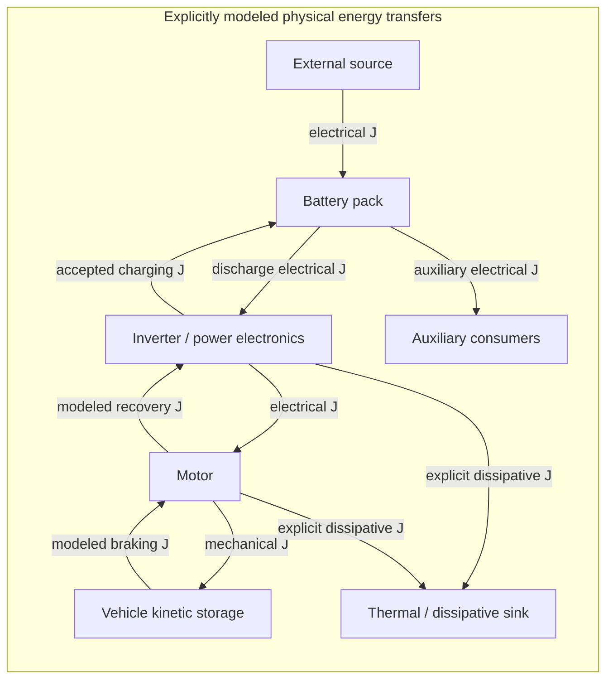

# DS-EV v9.0.0 — BEDROCK REFORGED: ENERGY CONTINUITY

**Status:** development release candidate; draft PR against `main`. No tag,
release publication, installation, or vehicle interaction is performed.

**Release-preparation baseline:** `main`
`593f58bfe9adf5887af31ab61702ad66421ff286`.
**Immutable historical baseline:** v8.0.1,
`e4f0417d48d9ed217ed3d4b0cfe3363e85a0199c`.
**Fresh validation and candidate identification:**
[SIMULATION_VALIDATION_9.0.0.md](SIMULATION_VALIDATION_9.0.0.md).

This document consolidates development already merged after v8.0.1 and the
bounded changes added by the final release-preparation PR. Historical remediation
results are identified as historical evidence. New code requires its own review
and execution record; it does not inherit the earlier independent audit verdict.

## Table of contents

1. [Executive overview](#1-executive-overview)
2. [Engineering history and major-version rationale](#2-engineering-history-and-major-version-rationale)
3. [Verified Git statistics](#3-verified-git-statistics)
4. [All fifteen BEDROCK findings](#4-all-fifteen-bedrock-findings)
5. [State integrity and numerical hardening](#5-state-integrity-and-numerical-hardening)
6. [BMS and regenerative accounting](#6-bms-and-regenerative-accounting)
7. [AILEE trust, learning, rollback and audit](#7-ailee-trust-learning-rollback-and-audit)
8. [Energy Continuity architecture](#8-energy-continuity-architecture)
9. [Physical boundaries and conservation equations](#9-physical-boundaries-and-conservation-equations)
10. [Evidence semantics](#10-evidence-semantics)
11. [Reproducible simulation](#11-reproducible-simulation)
12. [Build and test validation](#12-build-and-test-validation)
13. [Public compatibility and migration](#13-public-compatibility-and-migration)
14. [Limitations and unsupported physical claims](#14-limitations-and-unsupported-physical-claims)
15. [Upgrade guidance and future research](#15-upgrade-guidance-and-future-research)

## 1. Executive overview

v9.0.0 aligns the overall DS-EV release identity after the BEDROCK remediation
work and introduces an optional, passive Energy Continuity Layer. The new layer
accounts for explicitly described physical transfers in joules and reconciles
them against separately supplied stored-energy changes. It records missing or
dependent evidence without inventing heat, regeneration or physical efficiency.

The existing DS equations, accepted valid-input numerical behavior, middleware
acceptance boundary, recovery estimates and trust ownership remain separate.
Enabling continuity provides additional evidence; it does not authorize commands
or change the model, torque, regen or governance result.

The final preparation PR adds continuity contracts, adapters, deterministic
simulation and regression coverage, makes the bounded embedded Python trust
correction documented below, and aligns active product identifiers and release
documentation. The previous remediation phases produced the fifteen BEDROCK
corrections. Their history is preserved rather than attributed to this PR.

## 2. Engineering history and major-version rationale

The immutable v8.0.1 baseline includes the earlier raw-evidence, configured
protection-ceiling and malformed-governance repairs. Subsequent merged development
covered coherent DS/multi-cell transactions, lower-temperature/SOC policies,
synthetic-clock validation, repository identity and claims clarification,
authenticated updater/backup gates, offline legacy maintenance validation,
middleware/fallback numerical integrity, recovery accounting, and trust/learning
identity and audit serialization.

The [independent release-readiness audit](RELEASE_READINESS_AUDIT_9.0.0.md)
reviewed `038653cd6600318e36276001099960dc8c523c3a` and recommended **GO WITH
ACCEPTED LIMITATIONS for release preparation**. It did not review the Energy
Continuity implementation, the new Python boundary fix, or this final candidate.
Its earlier CI link and local execution claims retain their original scope.

The major version communicates accumulated compatibility changes, including the
nontrivial target-identity member in `ParameterEnvelope`, diagnostic additions,
explicit short-step exceptions, stricter initialization/fallback contracts,
committed-versus-attempt learning history, and corrected accepted-energy semantics.
The rationale is public behavior and ABI, rather than line count. Component APIs
with independent version identities keep those identities unless their own
contracts require a change.

## 3. Verified Git statistics

The following counts use a single Git comparison from immutable v8.0.1 to
the final candidate tree. Per-PR deltas are not summed. See the
[fresh validation report](SIMULATION_VALIDATION_9.0.0.md#git-statistics) for
source identification and reproduction.

<!-- BEGIN FINAL GIT STATISTICS -->
| Comparison | Commits | Files | Insertions | Deletions | Net lines |
|---|---:|---:|---:|---:|---:|
| v8.0.1 → final candidate | 37 | 62 | 12,795 | 1,341 | +11,454 |
| Preparation PR against inspected main | 2 | 22 | 2,938 | 38 | +2,900 |
<!-- END FINAL GIT STATISTICS -->

For historical context only, the earlier independent audit verified **34 commits,
51 changed files, 9,729 insertions and 1,325 deletions** from v8.0.1 to
`038653cd6600318e36276001099960dc8c523c3a`. Those figures are not the final
candidate totals. The preparation baseline includes a later audit-document commit.

Reproduce final metrics with the exact candidate SHA from the validation report:

```sh
git rev-list --count e4f0417d48d9ed217ed3d4b0cfe3363e85a0199c..HEAD
git diff --shortstat e4f0417d48d9ed217ed3d4b0cfe3363e85a0199c HEAD
git diff --numstat e4f0417d48d9ed217ed3d4b0cfe3363e85a0199c HEAD
```

## 4. All fifteen BEDROCK findings

All entries below describe historical bounded software-finding closure recorded
in the [reconciled backlog](POST_BEDROCK_REMEDIATION_BACKLOG.md) and phase reports.
Fresh regressions cover preservation within their tested scope; closure does not
mean a complete vehicle hazard analysis or independently calibrated physics.

| Finding | Resolved historical contract | Principal regression | Remaining boundary |
|---|---|---|---|
| PB-01 | Multi-cell candidates and cached statistics commit together | `test_state_integrity pack` | O(N) candidate storage; successful commits invalidate cell-element references |
| PB-02 | Direct coupling numerical failure preserves caller state | `test_state_integrity coupling` | Tested arithmetic paths and sampled valid inputs |
| PB-03 | Sub-minimum intervals reject before a mixed epoch is published | `test_state_integrity short` | No time buffering; caller must provide a supported interval |
| PB-04 | Direct RAPS, torque and regen reject malformed or overflowing evidence | `test_direct_numeric_boundaries`, `test_regen_boundaries`, `test_ailee_governor` | Configured software limits are not physical guarantees |
| PB-05 | Configured regen mechanical-power and voltage ceilings remain authoritative | `test_regen_boundaries` | Positive-speed enforcement needs actual RPM evidence |
| PB-06 | Lower-temperature and directional SOC policies expose faults/advisories | `test_middleware`, `test_remediation_reconciliation` | At-rest warnings do not establish actuator shutdown |
| PB-07 | Missing/rejected latest BMS cycle cannot authorize trust | `test_bms_adapter_evidence` | Adapter acceptance does not prove sensor freshness |
| PB-08 | Nonfinite, future and expired synthetic timing reject | `test_hardware_adapter`, `test_remediation_reconciliation` | Host monotonic-clock discipline remains external |
| PB-09 | Recovery history stages until BMS acceptance; charging credit follows accepted V/I | `test_recovery_integrity` | All-source charging lacks proven regenerative attribution |
| PB-10 | Rollback grant binds originating target address, lifetime, engine and label | `test_trust_learning_integrity` | Process-local grants; ABI rebuild; durable/live-revocation redesign outside scope |
| PB-11 | Trust policy and all authorization scores use finite ordered `[0,1]` domains | `test_trust_learning_integrity` | Reference software governance, without upstream equivalence claim |
| PB-12 | Committed snapshots and rejected attempts are separate; audit JSON preserves actual prior state | `test_learning_audit.py`, trust/allocation suites | External sink durability and authenticity unproved |
| PB-13 | Raw electrical intermediates, cumulative ledgers, time and counters validate before commit | `test_middleware_accounting` | Numeric acceptance is not physical-meter or safety validation |
| PB-14 | Outer/embedded nominal configuration must agree; failed reinitialization preserves the session | `test_middleware_configuration` | CUSTOM pack chemistry remains unsupported |
| PB-15 | Separate Python fallback rejects malformed inputs and stages complete candidate state | `test_fallback_integrity.py` | Approximate fallback has no proved C++ or physical equivalence |

Original failing reproductions, follow-up adversarial cases and historical commands
remain in [state integrity](STATE_INTEGRITY_REMEDIATION.md),
[numerical/middleware/fallback](NUMERICAL_MIDDLEWARE_FALLBACK_REMEDIATION.md), and
[recovery/learning/audit](RECOVERY_LEARNING_AUDIT_REMEDIATION.md). The final PR
preserves those records, existing safety tests and acceptance rules.

## 5. State integrity and numerical hardening

DS coupling computes its candidate before publishing. Multi-cell updates validate
the full input set and stage cells, weak flags and aggregate statistics. Core,
middleware, optional filter and fallback reject nonfinite intermediate arithmetic
before saturation or normalization can conceal a failure. A rejected accepted-state
transaction preserves time, throughput, gradients, metric and prior model outputs.

The established short-step contract is `dt >= tau_min`; `0 < dt < tau_min` throws
before mutation and is not accumulated. Valid mathematical expressions and their
operation order remain preserved by the earlier corrections. The existing
hexadecimal valid-input probe provides a sampled compatibility check, independent
of the new physical joule account. DS informational terms are never substituted
for separately observed physical transfers or stored-energy measurements.

Raw safety observations are a distinct channel: middleware safety faults/advisories
may describe a rejected attempt while its numeric diagnostics describe the last
accepted cycle. Callers must not interpret a retained snapshot as fresh acceptance.

## 6. BMS and regenerative accounting

Positive pack current means discharge; negative means charging. The middleware
owns the authoritative ledger for successfully accepted raw V/I/time cycles.
Coordinator current caps and smoothing determine the raw current submitted to
BMS; normalized DS model current does not redefine accepted electrical energy.

Coordinator `accepted_charging_energy_kwh_*` values observe accepted calls through
that coordinator. Legacy `recovered_energy_kwh_*` fields alias those observations.
The BMS and coordinator observations describe the same transfer and must not be
added together. Resetting coordinator session totals does not reset BMS energy
or the coordinator lifetime total.

Mechanical availability (`torque * shaft angular speed`) and electrical availability
(configured simulated efficiency) remain estimates before current limits and
smoothing. They are never credited as a second accepted charge. Measured negative
current has `UNATTRIBUTED_MEASURED` origin; estimated mode has
`SIMULATED_REGEN_ESTIMATE` origin. Neither establishes experimentally measured
regenerative recovery. The continuity adapters preserve that distinction.

## 7. AILEE trust, learning, rollback and audit

The implemented C++ reference trust gate retains configurable ordered thresholds,
inclusive equality and `noexcept` entry points. Invalid policy or out-of-domain
scores deny telemetry, learning and protective exit. Accepted rollback grants bind
their originating target lifetime and must satisfy current bounds; names alone do
not establish identity. Rejected attempts do not enter committed learning history.

Audit JSON escapes strings, emits finite numbers in a locale-independent format,
and records nonfinite rejected fields as `null` with explicit classifications.
Actual pre-restoration values are captured for rollback. In-memory staging does
not establish external file durability, cryptographic authenticity or distributed
target registration.

The final preparation corrects a separately confirmed reachable Python
`AileeTrustPipeline.process_raw()` defect: NaN/infinite raw values or confidence
could pass clamps and mutate `_history` while returning accepted output. The
compatible correction validates conversion, rejects booleans/nonfinite values
and confidence outside `[0,1]` before clamps, and returns a finite-zero rejected
decision without history mutation. Valid finite clamps, threshold equality,
numeric strings and custom policies remain supported. The current C++ embedded
governor calls `process()` through `evaluate_governance()`, so no actuator-path
impact from `process_raw()` is demonstrated. Exact reproductions and fresh
regressions appear in the validation report.

Broader upstream AILEE synchronization, including vendoring v10.0.2, remains
outside this release. Governance eligibility cannot manufacture physical energy
evidence or close a residual.

## 8. Energy Continuity architecture

Energy Continuity is a standalone opt-in physical accounting observer in
[`include/ds_energy_continuity.hpp`](../include/ds_energy_continuity.hpp), namespace
`ds::continuity`. Its seven `PhysicalNode` values name battery, power electronics,
motor, kinetic storage, thermal sink, auxiliary consumers and external source.
The layer does not implement a detailed plant for those nodes.

| Public contract | Responsibility |
|---|---|
| `TransferRecord` | Nonnegative joules, directed physical source/destination, interval, transfer identity, evidence and accepted/rejected eligibility |
| `Evidence` | Measured/calculated/simulated/estimated kind, origin, nonzero caller provenance ID, explicit independent-support declaration |
| `StorageObservation` | Nonnegative initial/final joules for one selected physical node, separately supplied evidence |
| `Batch` | Session/event identity, boundary, interval, at most 32 transfers and seven storage observations, completeness declarations, tolerances |
| `EnergyContinuityLedger::reconcile()` | Stage complete input validation and arithmetic, return rejected/balanced/imbalanced/insufficient-evidence result, commit only valid evidence |
| `LedgerSnapshot` | Fixed-size cumulative flux/storage/residual totals plus separate classification totals for physical transfers and available estimates |
| Conversion helpers | Checked signed battery V/I/time increments and checked J/kWh conversion |

The core ledger has no dynamic allocation or retained event-history container.
An event ID must be nonzero and strictly increase within its session; transfer IDs
must be nonzero and unique within an event. Multiple diagnostics representing the
same physical transfer must use one identity and one record. A batch must keep the
session boundary unchanged and cannot overlap the last committed interval. Gaps
are allowed; completeness describes each supplied batch, not an unobserved gap.
Storage endpoints are validated within each batch and are not linked across
events, including adjacent intervals. Balanced batches therefore establish only
their declared per-event equations; they do not certify continuous physical
storage history.

`reset(new_session_id)` requires a newer nonzero ID and clears all observer
session totals, event/time state and boundary. It cannot undo accepted BMS energy.
Malformed/rejected evidence and arithmetic overflow preserve the full prior
snapshot. Numerically valid imbalance or insufficient-evidence batches commit
their observations with the explicit status; commitment does not mean verified
balance or BMS acceptance. Every selected boundary node requires an explicit
storage observation, including zero change. Missing storage with no completeness
claim is insufficient evidence; claiming complete storage while omitting a selected
node rejects as malformed.

Integration reads accepted middleware/coordinator evidence and read-only telemetry
through narrow adapters. Existing public telemetry and diagnostic layouts remain
preserved by the new feature. Neither observer commitment nor an `accepted` field
causes BMS acceptance or trust authorization. Available-estimate records accumulate
separately and contribute no boundary flux or accepted battery credit. Physical
classification totals also include internal edges; they are not added to crossing
flux totals.

[`ds_energy_continuity_observer.hpp`](../include/ds_energy_continuity_observer.hpp)
provides pure factories: `capture_bms_checkpoint()` records the current accepted
counter/time/throughput/charging aliases; `observe_bms_cycle()` requires exactly
one newly accepted cycle and checks that raw power, duration and cumulative aliases
agree; `observe_recovery_cycle()` additionally validates the current coordinator
result and emits separate mechanical/electrical availability records. It uses the
BMS accepted counter as canonical event ID and the same battery transfer identity
for BMS and coordinator aliases. Callers choose one battery representation; adding
both with the same identity rejects as a duplicate.

Factories neither execute BMS cycles nor commit checkpoints or observer totals.
The caller deliberately retains `next_checkpoint` after its chosen acceptance
boundary and retains the old checkpoint on adapter/reconciliation rejection.
Charging's physical counterparty is a caller assertion; `ExternalSource` supports
unattributed incoming charging. Energy calculated from V/I/time remains calculated
(or simulated/estimated), not a measured joule value. Estimated-current recovery
forces dependent evidence, while both available recovery records remain estimates.
Existing APIs expose no BMS initialization generation: after every reinitialization,
the caller must begin a newer continuity session and capture anew. Checkpoints
require the same live component and exclusive caller access. Adapter failure cannot
undo a BMS cycle that was already accepted independently.

| Owner | Responsibility | Continuity boundary |
|---|---|---|
| DS core | Existing mathematical state and predictions | No reinterpretation of abstract `energy_phi`/metric terms as physical joules |
| BMS middleware | Accepted software-cycle raw electrical ledger | Read accepted evidence; never add a competing credit to BMS |
| Recovery coordinator | Accepted charging observations and separate available estimates | One accepted battery transfer; estimates remain distinct |
| Energy telemetry | Read-only state/power summary | A telemetry arrow carries information, not physical energy |
| Energy Continuity | Defined-boundary physical reconciliation | Report balance, imbalance or insufficient evidence |
| AILEE/host safety | Trust eligibility, authorization and independently owned control | No energy generation and no continuity actuator authority |

## 9. Physical boundaries and conservation equations

The diagram describes illustrative modeled physical paths. A node name does not
imply a detailed implemented plant model. Loss arrows require explicit supplied
evidence. Each boundary must define its storage and observed crossing transfers.



For one explicitly defined boundary:

\[
E_{initial}+E_{in}=E_{final}+E_{out}+E_{dissipated}
\]

With `Delta E_stored = E_final - E_initial`, the signed residual is:

\[
r=E_{in}-E_{out}-E_{dissipated}-\Delta E_{stored}.
\]

Each node's initial and final endpoints enter checked compensated sums
separately: storage change uses `+final, -initial`, while the residual uses
`+initial, -final, +in, -out, -dissipation`. This avoids both rounded pair
subtraction and subtraction of large aggregate inventory totals. Private staged compensation also preserves
small cumulative signed contributions through later cancellation. A fresh review
case with unchanged `1e20 J` storage, `1 J` inbound transfer and zero tolerance
therefore reports residual `+1 J`, rather than a false zero. Supplied double
representation limits and finite intermediate checks remain; this is not exact
real arithmetic or recovery of information absent from the observations.

A transfer to an explicitly identified dissipative sink is accounted once, as
dissipation rather than again as ordinary outflow. Internal transfers do not
cross the selected boundary. The reconciliation API uses inclusive comparison:

\[
|r|\le a+q\max(E_{initial},E_{final},E_{in},E_{out}+E_{dissipated},|\Delta E_{stored}|),
\]

where absolute tolerance `a` is in joules and relative tolerance `q` is
dimensionless. Both must be finite and nonnegative; tolerance arithmetic must
remain finite. The defaults are `a = 1e-6 J`, `q = 1e-9`. The scale uses explicit
accounting terms rather than the residual under assessment. Complete evidence
and caller-declared independent support are prerequisites for `Balanced` or
`Imbalanced`; otherwise a valid batch reports `InsufficientEvidence`. The status
remains conditional on those declarations rather than proving sensor independence.

Battery-side constant-interval observations use:

\[
\Delta E_{signed,J}=V I\Delta t,\qquad
\Delta E_{signed,kWh}=\frac{V I\Delta t}{3.6\times10^6}.
\]

Positive signed increments mean discharge; negative increments mean charging.
Physical transfer records use nonnegative magnitudes and explicit source/destination
direction. `1 kWh = 3,600,000 J`. Conversion and consumed intermediates require
finite arithmetic. A successful zero-energy interval is valid; malformed elapsed
time is not a fabricated no-op acceptance.

No unexplained residual becomes heat or an efficiency adjustment. A zero residual
from circular or dependent estimates is not independent conservation validation.

## 10. Evidence semantics

| Evidence | Meaning | Permitted interpretation |
|---|---|---|
| Measured | Integrator declares a physical observation and provenance | Observation classification, without sensor-authenticity guarantee |
| Calculated | Energy derived from supplied physical quantities, such as V/I/time | Preserve measurement origin and dependency assumptions |
| Simulated | Explicit modeled plant/input values in the deterministic example | Software simulation evidence only |
| Estimated | A model-derived quantity rather than a demonstrated observation | Keep provenance and dependencies explicit; available recovery is diagnostic only, while an estimated-mode accepted BMS cycle remains modeled battery evidence |
| Rejected | Malformed, ineligible or unsuccessfully accepted evidence | No committed ledger change |
| Incomplete/dependent | Missing required transfers/storage or lack of independent support | Insufficient evidence, even if arithmetic residual is zero |

The built-in APIs do not supply complete inverter, motor, auxiliary, thermal or
vehicle-energy measurements. Integrators must supply and identify such evidence
to reconcile those boundaries. Unsupported confidence/uncertainty values are not
invented. Provenance labels do not provide cryptographic authentication.

Evidence kind and quantity purpose are separate. `AvailableEstimate` records never
contribute boundary flux, regardless of their kind. `PhysicalTransfer` records can
carry estimated evidence, including a software-accepted BMS cycle from estimated
current; its dependent evidence cannot establish independently supported balance.
An `Estimated` label alone does not alter the existing BMS software ledger or turn
an availability diagnostic into a second physical transfer.

## 11. Reproducible simulation

The registered `energy_continuity_simulation` example uses fixed software inputs
and identifies every output as simulated. Scenarios exercise discharge, braking
recovery, explicit conversion dissipation, rejected evidence/timing, missing
physical evidence, extreme arithmetic, tolerance boundaries, duplicates, reset
and replay. Actual terminal values, independently calculated analytic expectations,
signed residuals and outcomes are recorded in
[SIMULATION_VALIDATION_9.0.0.md](SIMULATION_VALIDATION_9.0.0.md).

The configured four-step analytic fixture selects battery, power electronics,
motor and kinetic storage as its boundary. Motor and power-electronics storage
are explicitly zero. The thermal sink lies outside the boundary.

| Configured step | Battery initial → final (J) | Kinetic initial → final (J) | Signed battery V/I/time energy (J) | Explicit dissipative transfer (J) | Analytic residual (J) |
|---|---:|---:|---:|---:|---:|
| A/C discharge 1: `400 V`, `25 A`, `1 s` | 100,000 → 90,000 | 0 → 8,000 | +10,000 | 2,000 | 0 |
| A/C discharge 2: same inputs | 90,000 → 80,000 | 8,000 → 16,000 | +10,000 | 2,000 | 0 |
| B/C braking 1: `400 V`, `-15 A`, `1 s` | 80,000 → 86,000 | 16,000 → 8,000 | −6,000 | 2,000 | 0 |
| B/C braking 2: same inputs | 86,000 → 92,000 | 8,000 → 0 | −6,000 | 2,000 | 0 |

The fixture's initial 100,000 J becomes final 92,000 J plus explicit 8,000 J
of simulated dissipation. Its accepted battery charging is 12,000 J, or
`0.0033333333333333333 kWh`, observed once even though BMS and coordinator both
display aliases. Each braking step supplies 8,000 J mechanical availability and
7,000 J electrical availability from the explicit `0.875` efficiency assumption;
those estimates are separate from the accepted 6,000 J battery increment and
never create measured losses. These are fixture/analytic values; the fresh report
records the actual executed software formatting and outcomes.

```sh
cmake -S . -B build -DCMAKE_BUILD_TYPE=Release -DDS_ENABLE_PYTHON_GOVERNOR=OFF
cmake --build build --target energy_continuity_simulation test_energy_continuity
./build/energy_continuity_simulation
ctest --test-dir build -R energy_continuity --output-on-failure
```

The example has no hardware transport or actuator connection. Simulated thermal
transfers are explicit model inputs, not heat measurements inferred from residuals.
The scenario record does not imply an end-to-end calibrated vehicle plant.

## 12. Build and test validation

Fresh full Release, Debug ASan/UBSan, Python, optional integration and simulation
results belong to the final candidate's
[validation report](SIMULATION_VALIDATION_9.0.0.md). That report records commands,
environment, exact executed coverage, CI status and any unavailable activities.
Historical counts in earlier release/remediation reports are not fresh executions.

Fresh results: Release **22/22**, ASan/UBSan with leak detection **22/22**,
Python-governor **22/22**, FEEN **22/22** plus upstream **4/4**, Python
**203/203** with the optional extension and no skips. The new continuity suite
passes **334 checks**. All three registered simulations pass in all four builds.
The 883-line mathematical probe matches main and v8.0.1 byte-for-byte.
Hosted CI passes both jobs for the frozen implementation ([run 38147521080](https://github.com/dfeen87/DS-EV/actions/runs/38147521080)); final-head CI is reported with the draft PR.

The final gate reviews the complete diff, public layouts/signatures, one-credit
accepted-energy behavior, passive noninterference, rejected-transaction atomicity,
version identities and updater authentication. Release assertions and safety
tests remain enabled. Mathematical compatibility uses the independently archived
v8.0.1 probe oracle within its existing sampled scope.

## 13. Public compatibility and migration

| Active release surface | v9.0.0 alignment |
|---|---|
| CMake project, generated package export and CPack | Overall product version `9.0.0` |
| Makefile software log identity | `9.0.0`; operational recipes retain existing behavior |
| DS core `DS_VERSION_*`, CLI `--version` and version regression | Overall product version `9.0.0` |
| Python wrapper/orchestrator/fallback `__version__` | Additive module metadata `9.0.0`; wrapper metadata does not attest a separately loaded library |
| Optional pybind module `__version__` | Derives the compiled core release identity |
| Citation and active architecture/README | Candidate `9.0.0`; no publication date invented |
| Updater User-Agent | Product identity `9.0.0`; authentication and installation gates unchanged |

Independently versioned middleware, recovery, regen, torque, RAPS and REST APIs,
optional FEEN/pybind dependency pins, historical evidence, maintenance manifests
and vehicle firmware profile values are not globally replaced. CMake's existing
`SameMajorVersion` package compatibility policy means a consumer requiring major
8 must deliberately update its version request for the major 9 package.

Rebuild C++ consumers against v9.0.0 and evaluate changed public layout/behavior
from the merged remediation history. `ParameterEnvelope` is no longer a trivial
six-member raw-byte representation; target copy/move/replacement changes identity.
Use whole-envelope replacement for a new logical target and serialize external
ownership. Existing method signatures and six-value construction remain supported.
Short intervals now throw; advanced nominal values must agree in both configuration
copies; invalid numerical/trust/fallback evidence fails explicitly.

Learning consumers must distinguish `get_snapshots()` committed transitions from
`get_audit_records()` attempt history. Audit sinks must handle additive metadata,
JSON `null` classifications and escaped strings. Recovery consumers must treat
legacy recovered-energy fields as all-source accepted charging aliases and avoid
summing BMS and coordinator totals.

The new continuity types are separate and opt-in. Existing BMS, coordinator and
telemetry structures are not expanded merely to add continuity. No new actuator
or automatic-learning authority is introduced.

The offline maintenance migration path retains its authenticated **historical
v8.0.2 source identity** and independently trusted manifest digests. It is not a
general v9.0.0 installer. The shipped historical update URL/null SHA-256 pin remains
fail-closed; this PR invents neither a downloadable v9.0.0 asset nor its checksum.
See [installation guidance](INSTALL.md), the preserved
[legacy runbook](UPDATER_LEGACY_MIGRATION.md), and historical
[updater evidence](RELEASE_8.0.2.md). No privileged migration or deployment is tested.

## 14. Limitations and unsupported physical claims

The release provides research software accounting and regression evidence. It
does not establish measured regenerative recovery, thermodynamic efficiency,
calibrated SOC/storage estimates, battery lifetime or range improvements,
hardware performance, timing guarantees, sensor authentication, SIL/HIL results,
vehicle safety or automotive certification.

Boundary completeness and evidence independence depend on honest integrator
declarations and supplied observations. Arithmetic agreement is conditional on
those assumptions. A bounded observer can reject malformed records and duplicates
within its declared identity/session contract, but cannot infer all unobserved
flows or authenticate a sensor. Explicit uncertainty calibration, broader sensor
freshness, audit durability, distributed rollback grants and multithreaded host
ownership remain separate work.

Existing unregistered schematic examples may retain historical API mismatches.
Unavailable optional GPU/static-analysis/hardware activities are documented rather
than implied to pass. The independent earlier audit is preserved as evidence for
its reviewed commit, not retroactively extended to this feature.

## 15. Upgrade guidance and future research

1. Review the fresh validation report and draft PR at the exact candidate commit.
2. Rebuild downstream C++ integrations and adapt the explicit behavioral contracts
   above; keep control ownership and safety boundaries external to continuity.
3. Run software simulations and existing regressions in a non-actuating environment.
4. Opt into continuity only with defined physical boundaries, unique session/event
   identities, supported intervals and separately classified transfer/storage evidence.
5. Preserve authenticated updater pins and the historical migration contract.
   Provision genuine release bytes through independent trusted review only after
   an actual future publication and a separate administrator maintenance procedure.

Future research should independently characterize inverter/motor losses, pack
storage change, auxiliary loads and regeneration provenance, then compare modeled
accounts with calibrated measurements and uncertainty. Durable target registration,
live trust revocation, authenticated audit, host timing/concurrency assessment and
SIL/HIL remain focused follow-ups. They are not bundled into this bounded release
preparation. The PR remains draft; no merge, tag or release announcement follows.
